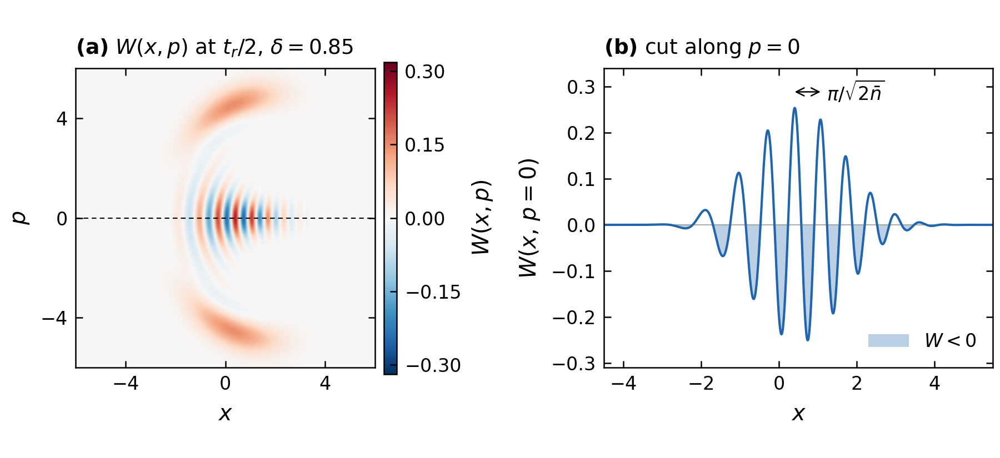
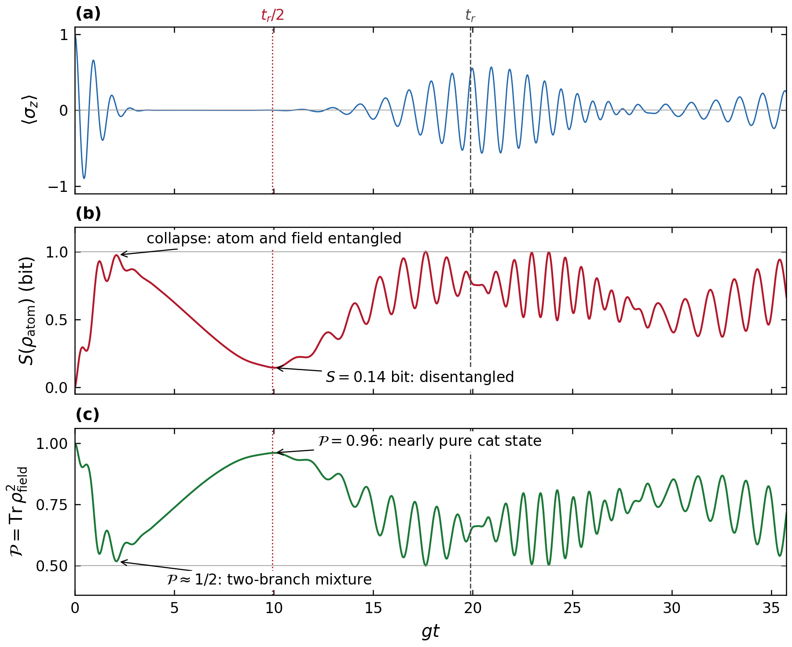
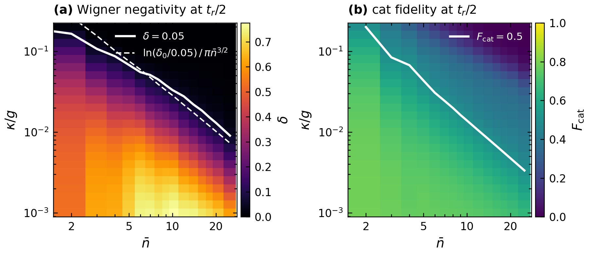

# QSOL_CQED

**Wigner-function dynamics and atom–field entanglement in the Jaynes–Cummings model**

[](LICENSE)
[](https://www.python.org/)
[](https://qutip.org/)
[](https://doi.org/10.5281/zenodo.22806075)

Nguyen Khoi Nguyen, Boston University. The project began as coursework in EC 585 and EC 777, taught by Prof. Luca Dal Negro.

<p align="center">
  
</p>

## What this is

QuTiP simulations of a single two-level atom coupled to a single cavity mode (the resonant Jaynes–Cummings model), followed through one collapse–revival cycle with three observables side by side: the Wigner function of the cavity field, the atom–field entanglement, and the effect of cavity loss. Every figure in the accompanying manuscript is produced by a script in `simulations/`, and all quantities were convergence-checked against the Fock-space truncation.

The physics is textbook and classic-literature material (Eberly 1980, Gea-Banacloche 1990–91, Phoenix and Knight 1988–91). The contribution is a verified, reproducible computational route through it with modern metrics: Wigner negativity, logarithmic negativity, and cat-state fidelity.

## Main results (initially excited atom, coherent field, n̄ = 10)

| Quantity | Value |
|---|---|
| Wigner negativity δ of the field at t_r/2 | 0.85 (0.31 at t_r) |
| Field purity at t_r/2 | 0.96 |
| Fidelity to the best two-component cat | 0.78, and independent of n̄ for n̄ = 2–25 |
| Reduced atomic entropy at t_r/2 | 0.14 bit, the minimum of the cycle |
| Thermal field: reduced entropy vs log-negativity | 1.0 bit vs ≈ 0.2 |
| δ after cavity loss κ/g = 0.02 | 0.14 (an 83 % reduction) |
| Cat-survival boundary δ = 0.05 | κ_c/g = 0.033 at n̄ = 10; ≈ 0.95 n̄^−1.43 for n̄ ≥ 10 |
| Fringe visibility under loss | δ/δ₀ ≈ exp(−πκn̄^{3/2}/g): 0.14 predicted, 0.17 simulated at κ/g = 0.02 |
| Photon blockade, drive on the polariton, g/κ = 5 and 10 | g²(0) = 0.10 and 0.03 |

Closed forms from the second order of the expansion of the Rabi frequencies (each tested against the exact state; see `paper/ejp/jc_beyond_linear.pdf`):

| Quantity | Closed form (n̄ → ∞) | Exact at n̄ = 10 / 100 |
|---|---|---|
| Amplitude of the k-th revival | (1+π²k²)^(−1/4) = 0.551 for k = 1 | 0.550 / 0.551 |
| Photon-number parity at t_r/2 | −(1+π²/4)^(−1/4) cos(πn̄ − 0.502) = ∓0.642 | −0.641 / −0.642 |
| Fidelity with an ideal cat | (1+π²/16)^(−1/2) = 0.786 | 0.780 / 0.786 |
| Wigner negativity at t_r/2 | (2/π)(1+π²/4)^(1/4) = 0.869 | 0.851 / 0.867 |
| Field impurity at t_r/2 | 1 − P = (4+π²)/(32 n̄) | 0.040 / 0.0043 |

The picture behind them: each of the two field components rotates by φ = gt/(2√n̄) and is sheared by the same amount, because its angular velocity depends on photon number.

<p align="center">
  <br>
  <em>Exact Wigner function for n̄ = 10 and 40 with the rotation-and-shear prediction drawn on top (no adjustable parameter), and the overlap of the two components.</em>
</p>

Three points that standard presentations leave implicit:

1. **The cat state coincides with a minimum of entanglement.** During the collapse the atom and field are maximally entangled and the reduced field is a two-branch mixture (purity 0.5). At half the revival time they disentangle and the field is left as a nearly pure cat.
2. **Reduced entropy is an entanglement measure only for pure global states.** A thermal field saturates it at one bit while the logarithmic negativity stays near 0.2.
3. **Cavity loss destroys the cat's internal coherence long before it changes the atom–field entanglement.**

<p align="center">
  <br>
  <em>Cat state at t = t_r/2: (a) two lobes on the p axis joined by interference fringes; (b) the cut along p = 0, reaching W = −0.25.</em>
</p>
<p align="center">
  <br>
  <em>(a) Inversion, (b) atomic entropy and (c) field purity through one collapse–revival cycle.</em>
</p>
<p align="center">
  <br>
  <em>Cat survival in the (n̄, κ/g) plane at t_r/2: (a) Wigner negativity with the δ = 0.05 boundary (solid) and the analytic estimate (dashed); (b) cat fidelity.</em>
</p>

Captions for all twelve animations and every repository figure are in [docs/gallery.md](docs/gallery.md); supplementary derivations are in [docs/extended_theory.md](docs/extended_theory.md).

## Repository layout

```
paper/            qsol_cqed.tex + qsol_cqed.pdf (REVTeX), figures/, ejp/ (IOP journal versions),
                  aps/ (REVTeX version of the rotation-and-shear article, generated)
simulations/      one script per figure group; animation/ holds the GIF generators;
                  plotstyle.py (shared figure style) and utils.py (shared physics helpers)
figures/          repository-only figures (PNG + PDF) and the .npz sweep data
animations/       twelve GIFs: nine for the first article, three for the rotation-and-shear article
docs/             figure gallery with captions, extended theory notes
tools/            set_release_doi.py: writes a release's version and Zenodo DOI into every file that cites the code
```

## Install and run

```bash
git clone https://github.com/alanknguyen/QSOL_CQED.git
cd QSOL_CQED
pip install -r requirements.txt
```

Scripts write to repo-relative paths and can be run from any directory. Timings are for a laptop with QuTiP 5.2.3. Every figure is drawn at its printed size (15.3 cm wide, 8–10 pt text) and saved as PNG and vector PDF.

| Script | Produces | Time |
|---|---|---|
| `simulations/sim_wigner_evolution.py` | paper Figs. 1–4 | 10 s |
| `simulations/sim_entanglement_dynamics.py` | paper Figs. 5–8 | 3 min |
| `simulations/jaynes_cummings_comparison.py` | paper Fig. 9 | 5 s |
| `simulations/wigner_quantum_states.py` | paper Figs. 10–11 | 10 s |
| `simulations/mollow_triplet.py` | paper Fig. 12 | 5 s |
| `simulations/sim_phase_diagram.py` | cat-survival phase diagram, `figures/phase_diagram_data.npz` (`--replot` redraws from the saved data) | 6 min |
| `simulations/sim_g2_coherence.py` | photon-blockade figures, `figures/g2_data.npz` | 30 s |
| `simulations/sim_rotation_shear.py` | the five figures and the table of the rotation-and-shear draft (closed forms against the exact state) | 1 min |
| `simulations/sim_numerics_checks.py` | truncation, integrator, grid and sampling errors against the exact solution | 15 s |
| `simulations/sim_detuned_shear.py` | exploratory: rotation and shear with detuning, heralded cat states and cavity loss (`fig_detuned_shear`); not yet in any manuscript | 1 min |
| `simulations/check_detuned_steps.py` | checks each step of the derivation notes `paper/notes/detuned_derivation.pdf` against the exact state (prints only) | 5 s |
| `simulations/animation/sim_*.py` | avoided crossing, photon-number, Bloch-vector, Q-vs-Wigner figures and GIFs | 20–60 s each |
| `simulations/animation/anim_*.py` | the remaining GIFs; `anim_rotation_shear`, `anim_parity_comb` and `anim_cat_limit` belong to the rotation-and-shear article, and `anim_phase_diagram` needs `figures/phase_diagram_data.npz` | 10 s to 3 min each |

## Reproducibility notes

- **Conventions.** Wigner negativity δ = ∫|W| dx dp − 1 (Kenfack–Życzkowski), which is twice the integrated negative volume. Phase space a = (x + ip)/√2, so ∫W dx dp = 1 and |W| ≤ 1/π; all Wigner maps share that colour scale. Operational collapse time t_c ≡ 1/g; revival time t_r = 2π√n̄/g.
- **Truncation.** Coherent and Fock states use N_cav = 35–50. Thermal and squeezed-vacuum states have heavy photon-number tails: at N_cav = 50 they would have ⟨n⟩ = 9.57 (thermal) and 8.23 (squeezed vacuum, exact Fock amplitudes) instead of 10. The thermal state uses N_cav = 150 and the squeezed vacuum N_cav = 300 (its weight beyond n = 150 is still 1.6 × 10⁻⁴).
- **Entanglement.** The reduced-atom entropy is reported for pure global states; the logarithmic negativity E_N = log₂‖ρ^T_atom‖₁ is used whenever the global state is mixed.
- **Cat fidelity** is against the best-fitting two-component cat with branches near ±i√n̄; the JC cat lives on the p axis and its relative phase depends on n̄ (photon-number parity −0.64 for even integer n̄, +0.64 for odd), so comparing with the even cat |α⟩ + |−α⟩ on the real axis gives F ≈ 0 and is not meaningful.
- **Photon blockade** sweeps drive the lower polariton (Δ = ω_c − ω_L = g). On bare-cavity resonance in strong coupling the cavity is nearly empty and g²(0) ≫ 1, which is bunching, not blockade.
- **Solver.** QuTiP `mesolve` with the default Adams integrator (atol 1e-8, rtol 1e-6); state vectors for pure unitary runs, density matrices otherwise. Environment: QuTiP 5.2.3, NumPy 2.4, SciPy 1.15, Matplotlib 3.10.

## Paper

- `paper/qsol_cqed.pdf`: manuscript (REVTeX 4.2). Rebuild with `cd paper && tectonic qsol_cqed.tex`.
- `paper/ejp/`: the same article in IOP Publishing's `iopjournal` format for the European Journal of Physics, with submission guidelines.
- `paper/ejp/jc_beyond_linear.pdf` and `jc_beyond_linear_supp.pdf` (draft): a restructured article, "Rotation and shear in the Jaynes–Cummings model", built around the next orders of the expansion of the Rabi spectrum, with a supplement on derivations and numerical methods.
- `paper/aps/jc_beyond_linear_aps.pdf` and `jc_beyond_linear_aps_supp.pdf`: the same article and its Supplemental Material in APS style (REVTeX 4.2, two columns). They are generated: edit the sources in `paper/ejp/`, run `python3 paper/ejp/tools/make_aps_revtex.py`, then `cd paper/aps && tectonic jc_beyond_linear_aps.tex && tectonic jc_beyond_linear_aps_supp.tex`.
- `paper/aps/jc_beyond_linear_aps_research.pdf` and `jc_beyond_linear_aps_research_supp.pdf`: a research-journal cut of the APS version, written by the same script: no teaching section, no exercises, no sentences addressed to students; everything else is identical.

## Citation

```bibtex
@software{nguyen2026qsolcqed,
  author  = {Nguyen, Nguyen Khoi},
  title   = {QSOL\_CQED: Wigner-function dynamics and atom-field entanglement in the Jaynes-Cummings model},
  year    = {2026},
  version = {1.1.0},
  publisher = {Zenodo},
  doi     = {10.5281/zenodo.22806076},
  url     = {https://doi.org/10.5281/zenodo.22806076}
}
```

The DOI above identifies release v1.1.0, the version behind the manuscript's figures; [10.5281/zenodo.22806075](https://doi.org/10.5281/zenodo.22806075) always resolves to the latest release. See also `CITATION.cff`.

## License and acknowledgments

MIT License. Simulations use [QuTiP](https://qutip.org/) (Johansson, Nation and Nori). The project began as coursework in EC 585 and EC 777 at Boston University, taught by Prof. Luca Dal Negro.
