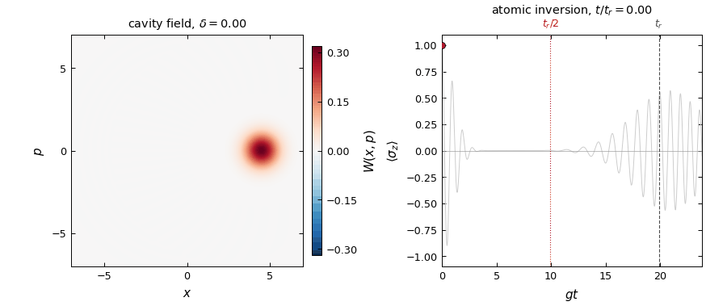
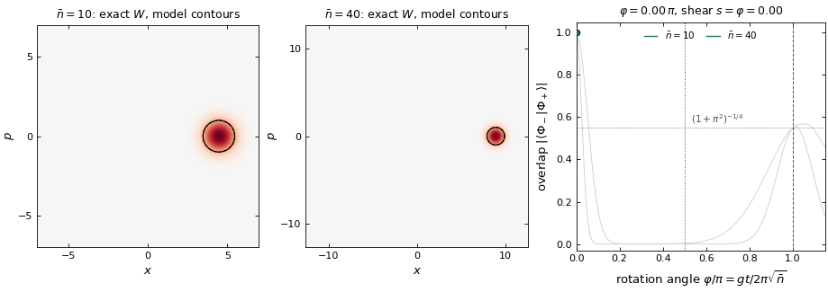
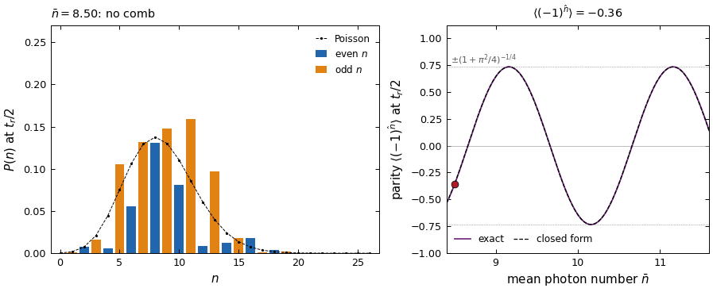
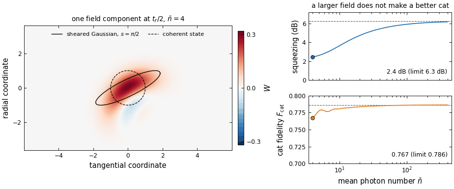

<div align="center">

<h2> Quantum States of Light in Cavity QED </h2>
</div>

[](LICENSE)
[](https://www.python.org/)
[](https://qutip.org/)
[](https://doi.org/10.5281/zenodo.22806075)

Simulations of the Jaynes–Cummings model: Wigner-function dynamics, atom–field entanglement, cavity loss, and closed-form results from the second-order expansion of the Rabi frequencies. Every figure and animation of the two accompanying manuscripts is generated here.

### Requirements

* Python 3.10+
* [QuTiP 5](https://qutip.org/), NumPy, SciPy, Matplotlib and Pillow (`pip install -r requirements.txt`)

### Collapse, revival and the cat state

Run this to follow the cavity field and the atom through one collapse and revival of the Rabi oscillations, for a coherent field of n̄ = 10 photons. At half the revival time the entanglement entropy falls to 0.14 bit and the field is left in a Schrödinger cat state of purity 0.96.

```bash
python simulations/animation/anim_entanglement.py
```
<p align="center">

</p>

### Cavity loss

Run this to tour the phase diagram of the cat state. Loss erases its interference fringes roughly as exp(−πκn̄<sup>3/2</sup>/g), so a larger cat survives only a smaller loss rate.

```bash
python simulations/animation/anim_phase_diagram.py
```

The map is the stored sweep of `simulations/sim_phase_diagram.py`, which takes six minutes to recompute.

<p align="center">

</p>

### Rotation and shear

Run this to compare the exact Wigner function with a prediction that has no adjustable parameter: each field component rotates by φ = gt/2√n̄ and is sheared by the same amount. The overlap of the two sheared components gives the height of the first revival, (1 + π²)<sup>−1/4</sup> = 0.55.

```bash
python simulations/animation/anim_rotation_shear.py
```
<p align="center">

</p>

### Odd or even cat?

Run this to sweep the mean photon number and watch the photon-number comb at half the revival time flip between odd and even. The parity follows −cos(πn̄ − 0.502)/(1 + π²/4)<sup>1/4</sup>.

```bash
python simulations/animation/anim_parity_comb.py
```
<p align="center">

</p>

### A larger field does not make a better cat

Run this to watch one component of the cat state as the field grows from n̄ = 4 to 400. It converges to a fixed sheared Gaussian, so the fidelity with an ideal cat state never exceeds (1 + π²/16)<sup>−1/2</sup> = 0.786.

```bash
python simulations/animation/anim_cat_limit.py
```
<p align="center">

</p>

### Figures of the manuscripts

Run these to regenerate the figures and tables of the two manuscripts.

```bash
python simulations/sim_wigner_evolution.py         # I: Wigner functions, cat state, decoherence
python simulations/sim_entanglement_dynamics.py    # I: entropy, purity, logarithmic negativity
python simulations/sim_rotation_shear.py           # II: Figs. 1-5 and Table II
python simulations/sim_numerics_checks.py          # II: numerical errors against the exact solution
python simulations/sim_phase_diagram.py --replot   # phase diagram, from the stored sweep
```

* I. [Quantum states of light in cavity QED](paper/qsol_cqed.pdf)
* II. [Rotation and shear in the Jaynes–Cummings model](paper/aps/jc_beyond_linear_aps.pdf), with its [Supplemental Material](paper/aps/jc_beyond_linear_aps_supp.pdf)

### What is under the hood?

The lossless model has an exact solution as a sum over photon number. Every closed form is compared with that sum, and the numerical methods (Fock-space truncation, integrator tolerance, phase-space grid, time sampling) are measured against it in `simulations/sim_numerics_checks.py`. Runs with cavity loss use QuTiP's `mesolve`.

### To Cite

```bibtex
@software{nguyen2026qsolcqed,
  author  = {Nguyen, Nguyen Khoi},
  title   = {QSOL\_CQED: Wigner-function dynamics and atom-field entanglement in the Jaynes-Cummings model},
  year    = {2026},
  version = {1.2.0},
  publisher = {Zenodo},
  doi     = {10.5281/zenodo.24262358},
  url     = {https://doi.org/10.5281/zenodo.24262358}
}
```

The DOI above identifies release v1.2.0, the version behind the manuscripts' figures; [10.5281/zenodo.22806075](https://doi.org/10.5281/zenodo.22806075) always resolves to the latest release.

### Explore more

* [Gallery](docs/gallery.md): all twelve animations and the repository figures, with captions
* [Extended theory notes](docs/extended_theory.md)

MIT License. Nguyen Khoi Nguyen, Boston University. The project began as coursework in EC 585 and EC 777, taught by Prof. Luca Dal Negro.
