# Figure and animation gallery

Captions for every animation and repository figure, with the physics as corrected in September 2026 and the figures redrawn in November 2026 (one shared style, `simulations/plotstyle.py`; every Wigner map uses the same colour scale, $|W| \le 1/\pi$). Paper figures are described in the manuscript itself ([../paper/qsol_cqed.pdf](../paper/qsol_cqed.pdf)). The animations were rendered again on 15 November 2026: the frames on which they pause now fall exactly on $t_r/2$ and $t_r$, so the numbers printed in them are those quoted in the papers, and three animations for the rotation-and-shear article were added. Conventions: $\delta = \int|W|\,dx\,dp - 1$, $a = (x+ip)/\sqrt{2}$, $t_c \equiv 1/g$, $t_r = 2\pi\sqrt{\bar n}/g$.

---

## Animations

### Wigner Function Evolution

  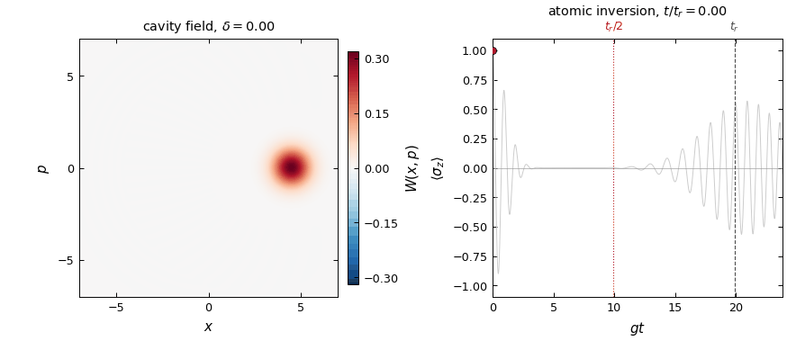

A coherent state $|\alpha = \sqrt{10}\rangle$ evolves under the resonant JC Hamiltonian. During the collapse of the Rabi oscillations the intracavity field splits into two components that travel in opposite directions around the circle $x^2+p^2 = 2\bar n$; while they separate the reduced field is a *mixture* of the two. **Left:** Wigner function $W(x,p)$ of the reduced cavity field $\rho_\text{field} = \mathrm{Tr}_\text{atom}[\rho]$ on a 281×281 grid, with its negativity $\delta$ in the title. **Right:** Atomic inversion $\langle\sigma_z\rangle(t)$ with a moving time marker (solved on a time grid twenty times finer than the frame spacing). The animation pauses at $t = t_r/2$, where the atom and field approximately **disentangle** and the two components form a nearly pure Schrödinger cat (purity 0.96, $\delta = 0.85$, fringes with $W < 0$), and at the first revival $t_r = 2\pi\sqrt{\bar{n}}/g$, where the components meet again and the atom and field are strongly entangled once more.

### Entanglement, Inversion, and Purity

  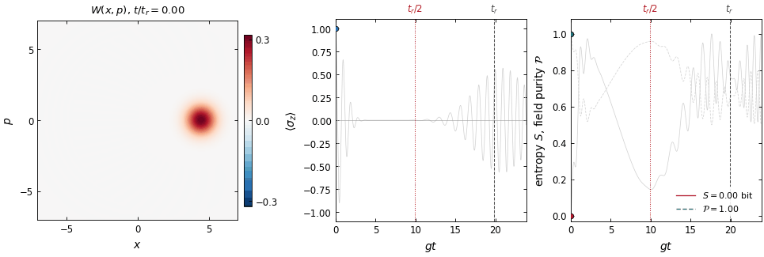

Simultaneous evolution of three complementary observables. **Left:** Wigner function $W(x,p)$. **Center:** Atomic inversion $\langle\sigma_z\rangle(t)$. **Right:** Von Neumann entanglement entropy $S(\rho_\text{atom})$ (solid red) and field-state purity $\mathrm{Tr}[\rho_\text{field}^2]$ (dashed green), with their current values in the legend. Entropy rises to 1 bit during the collapse (atom and field maximally entangled) while the field purity drops to ~0.5: the reduced field is then a statistical mixture of two near-orthogonal branches. At $t = t_r/2$ the entropy falls to its minimum ($0.14$ bit) and the purity peaks at 0.96: the atom and field disentangle and the field is left in a nearly pure cat state. Toward the revival the entanglement grows again ($S \approx 0.8$ bit at $t_r$).

### Decoherence Destroys the Cat State

  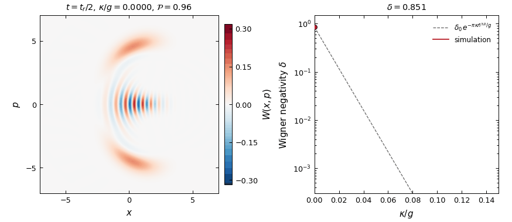

Cavity photon loss via the Lindblad dissipator $\kappa \mathcal{D}[a]$ erases the coherence between the two field components at the rate $\kappa|\Delta\alpha|^2/2$, which grows to $2\kappa\bar{n}$ as they separate, far faster than the energy decay rate $\kappa$. **Left:** Wigner function at the cat-state time $t = t_r/2$ as $\kappa/g$ increases from 0 to 0.15 (in steps that grow quadratically, so that the fringes do not vanish within the first few frames). The interference fringes vanish first, while the two lobes persist: the state decoheres into a classical mixture. **Right:** Wigner negativity $\delta$ on a logarithmic scale (red) next to the one-line estimate $\delta_0\exp(-\pi\kappa\bar{n}^{3/2}/g)$ (dashed), obtained by integrating that rate up to $t_r/2$. The estimate is good while $\delta$ is dominated by the fringes ($\kappa/g \lesssim 0.03$); beyond that the simulated $\delta$ stays above it.

### Dressed-State Avoided Crossing

  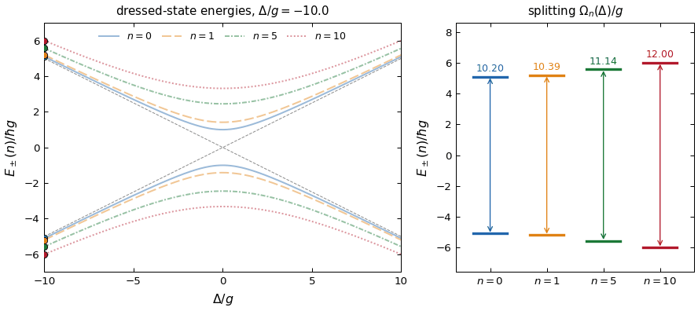

The JC dressed states $|n, \pm\rangle$ are the exact eigenstates of the coupled atom-cavity system. As the atom-cavity detuning $\Delta = \omega_a - \omega_c$ is swept, the bare-state energies (dashed grey) would cross, but the JC interaction opens an avoided crossing with a gap of $2g\sqrt{n+1}$. **Left:** the energies $\pm\tfrac12\Omega_n(\Delta)$ for manifolds $n = 0, 1, 5, 10$ with markers at the current detuning. **Right:** the four level pairs and their splitting $\Omega_n(\Delta)/g$ at that detuning. At large detuning the dressed states approach the bare (uncoupled) states; on resonance the hybridization is maximal.

### Photon Number Distribution Dynamics

  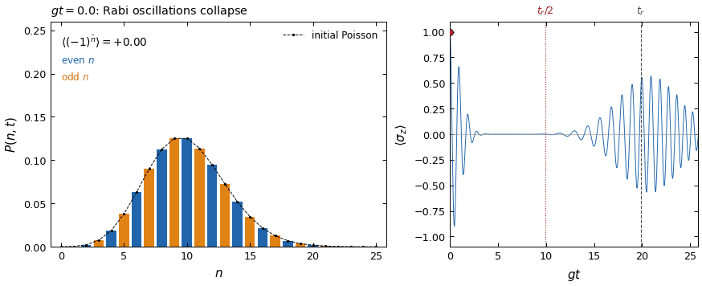

Time evolution of the intracavity photon number distribution $P(n, t) = \langle n|\rho_\text{field}(t)|n\rangle$ for an initial coherent state with $\bar{n} = 10$ (bars: even $n$ blue, odd $n$ orange, with the parity $\langle(-1)^{\hat n}\rangle$ printed in the frame), with the initial Poisson distribution for reference (dashed black). The two components of the half-revival cat have the *same* amplitude $|\beta| = \sqrt{\bar{n}}$ and opposite phases ($\beta = \pm i\sqrt{\bar{n}}$), so their Poisson envelopes coincide; what $P(n,t)$ shows at $t = t_r/2$ is their **parity interference**: an odd-$n$ comb ($P(\text{odd}) = 0.82$, $\langle(-1)^{\hat n}\rangle = -0.64$). Which parity wins depends on $\bar n$: the comb is odd for even integer $\bar n$ and even for odd integer $\bar n$ (parity $+0.64$ for $\bar n = 9$ or 11). At the first revival the comb washes out and a broadened single-hump distribution returns; it never fully returns to Poissonian because of the anharmonic $\sqrt{n+1}$ Rabi spectrum.

### Bloch Sphere Trajectory

  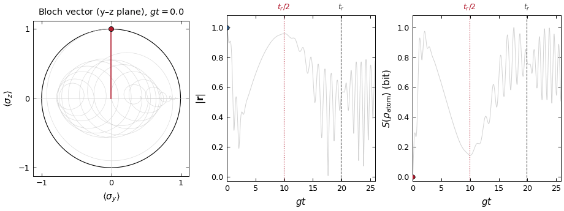

The reduced atomic state $\rho\_{\text{atom}} = \mathrm{Tr}\_{\text{field}}[\rho]$ traces a trajectory inside the Bloch sphere. A pure atomic state sits on the surface ($|\mathbf{r}| = 1$); entanglement with the field pulls the Bloch vector toward the center ($|\mathbf{r}| \to 0$, maximally mixed). For a real coherent amplitude on resonance $\langle\sigma_x\rangle = 0$ at all times, so the trajectory lies in the $y$–$z$ plane. **Left:** the Bloch vector in that plane, colour-coded by time. The atom starts at the excited state (top of the unit circle) and spirals inward during the collapse. Near $t = t_r/2$ it returns close to the surface on the $\sigma_y$ axis ($|\mathbf{r}| = 0.96$): the atom is nearly pure again because it has **disentangled** from the field, which is then in a cat state. Around the first revival the Bloch vector is back inside ($|\mathbf{r}| \approx 0.5$) as the components meet and re-entangle. **Center:** Bloch vector length $|\mathbf{r}|(t)$. **Right:** Von Neumann entropy $S(\rho\_{\text{atom}}) = h\bigl((1+|\mathbf{r}|)/2\bigr)$.

### Wigner vs Husimi Q-Function

  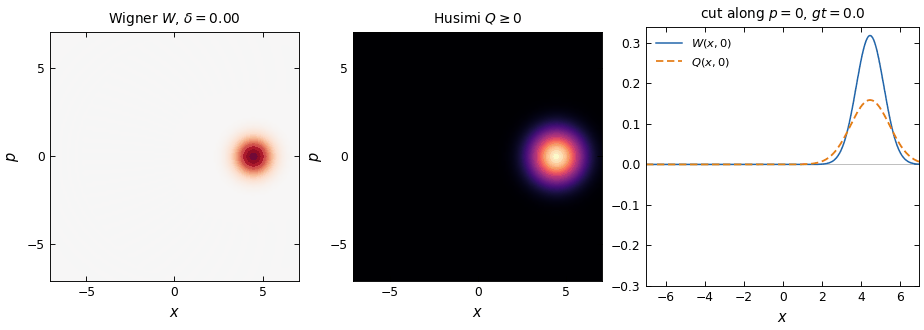

Wigner function $W(x,p)$ (left), Husimi Q function $Q(x,p) = \langle\alpha|\rho|\alpha\rangle/2\pi$ with $\alpha = (x+ip)/\sqrt2$ (middle), and their cuts along $p = 0$ (right) during JC evolution with $\bar{n} = 10$. The Wigner function takes negative values; the negativity $\delta$ is shown in its title. The Husimi Q is a Gaussian-smoothed Wigner function ($Q = W * G_\text{vacuum}$) and is non-negative by construction. At $t = t_r/2$ the Wigner function resolves the interference fringes sharply, while the Q function shows only two smooth lobes: the fringe period (0.70) is smaller than the smoothing width. This demonstrates that Wigner negativity, not Q-function structure, is the proper witness of quantum coherence in phase space.

### Phase Diagram of the Cat State

  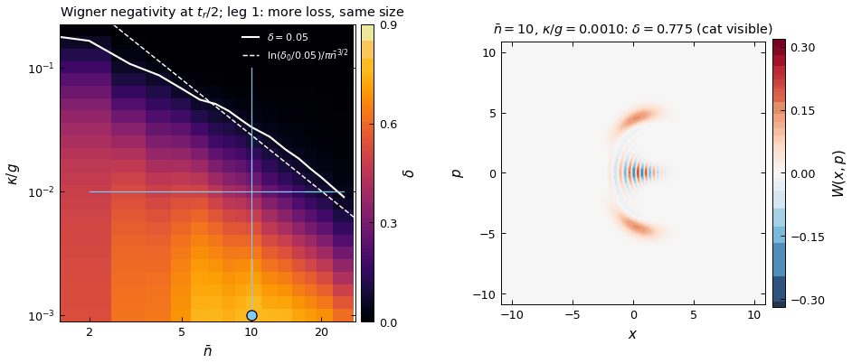

A tour of the cat-survival phase diagram. **Left:** the Wigner negativity $\delta(\bar n, \kappa/g)$ of the reduced field at $t_r/2$ (the stored sweep of `sim_phase_diagram.py`), with the simulated boundary $\delta = 0.05$ (solid white) and the estimate $\kappa_c = \ln(\delta_0/0.05)/\pi\bar n^{3/2}$ (dashed). The marker walks two legs. On the first, $\bar n = 10$ and $\kappa/g$ rises from 0.001 to 0.1: at a fixed size, loss erases the fringes, and the boundary is crossed at $\kappa/g = 0.033$. On the second, $\kappa/g = 0.01$ and $\bar n$ grows from 2 to 25: at a *fixed* loss rate a larger cat is more fragile, because the coherence between its components decays at up to $2\kappa\bar n$ for a time that itself grows as $\sqrt{\bar n}$; the boundary is crossed near $\bar n = 23$. **Right:** the Wigner function at the marker, recomputed for each frame on one fixed window, so that the cat is seen to grow along the second leg while its fringes become finer and then disappear. (Until November 2026 this file showed a sweep of $\kappa$ at $\bar n = 10$ only, which duplicated the previous animation.)

### Photon Blockade Transition

  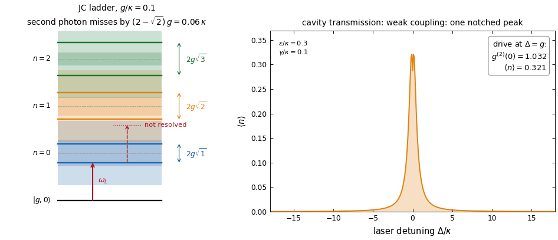

The transition from weak to strong coupling as $g/\kappa$ is swept from 0.1 to 12 (drive $\varepsilon/\kappa = 0.3$, $\gamma/\kappa = 0.1$). **Left:** the JC ladder: the ground state and the first three doublets ($n = 0, 1, 2$, splittings $2g\sqrt{n+1}$), drawn to scale in units of $g$, with shaded bands for the polariton linewidth $(\kappa+\gamma)/2$ that shrink as $g/\kappa$ grows. The solid arrow is a laser photon tuned to the lower polariton, $\omega_L = \omega_c - g$; the dashed arrow is a second photon of the same frequency, which lands $(2-\sqrt2)\,g$ below the next level and is **blocked** once that mismatch exceeds the linewidth. **Right:** Cavity transmission spectrum $\langle n \rangle(\Delta)$ from the steady-state Lindblad equation at each $g/\kappa$. At weak coupling ($g \ll \kappa$) the spectrum is a single Lorentzian at $\Delta = 0$, with a narrow notch of width $\gamma$ where the atom absorbs. At $g/\kappa \gtrsim 2$ it splits into two resolved peaks at $\Delta = \pm g$ (dotted lines), the **vacuum Rabi doublet**; the small shoulders at $\Delta = \pm g/\sqrt2$ are the two-photon resonances. The box gives $g^{(2)}(0)$ and $\langle n \rangle$ for the drive on the lower polariton ($\Delta = \omega_c - \omega_L = g$): $g^{(2)}(0)$ falls from ~1 to about 0.06 at $g/\kappa = 10$ for this drive strength (0.03 in the weak-drive limit). Driving on *bare-cavity* resonance ($\Delta = 0$) in strong coupling gives the opposite: the laser is detuned from both polaritons, $\langle n\rangle$ collapses and $g^{(2)}(0) \gg 1$ (bunching), so that is not the blockade signature.

---

---

## Animations for the rotation-and-shear article

These three belong to *Rotation and shear in the Jaynes–Cummings model* ([IOP layout](../paper/ejp/jc_beyond_linear.pdf), [APS layout](../paper/aps/jc_beyond_linear_aps.pdf)). All are computed from the exact amplitudes; no differential equation is solved.

### Rotation and Shear

  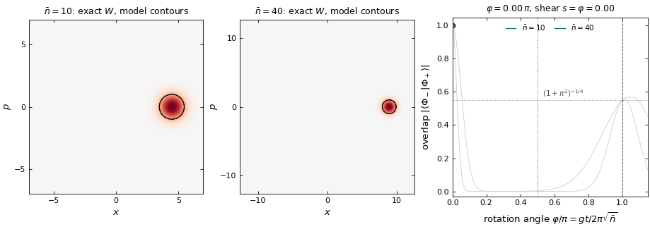

The exact Wigner function of the cavity field for $\bar n = 10$ (left) and $\bar n = 40$ (middle) at equal rotation angle $\varphi = gt/2\sqrt{\bar n}$, with the prediction of the rotation-and-shear picture drawn on top and no adjustable parameter: each black curve is the $1/e$ contour of a Gaussian at distance $\sqrt{2\bar n}$ from the origin, at angle $\mp gt/2\sqrt{\bar n+1}$, sheared by $s = \varphi$. The first order of the expansion of the Rabi frequencies rotates the two components; the second order shears each by an amount equal to its rotation angle. **Right:** the overlap $|\langle\Phi_-|\Phi_+\rangle|$ of the two components, which is the envelope of the atomic inversion. It collapses as soon as they separate and returns only to $(1+\pi^2)^{-1/4} = 0.55$ at $\varphi = \pi$, where they coincide in position but are sheared in opposite senses. The animation pauses at $\varphi = \pi/2$ (the cat state, shear $\pi/2$) and at $\varphi = \pi$ (the revival). For $\bar n = 40$ the contours follow the exact state closely; for $\bar n = 10$ the components are visibly bent along the circle, which is the $\bar n^{-1/2}$ correction discussed in the paper.

### The Half Revival Is a Revival of the Parity

  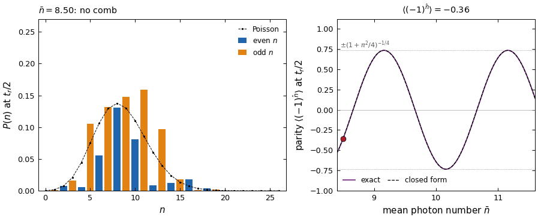

Whether the cat state is "odd" or "even" is a matter of the Rabi phase. The mean photon number is swept from 8.5 to 11.5 and the field is examined each time at $t_r/2 = \pi\sqrt{\bar n}/g$. **Left:** the photon-number distribution (even $n$ blue, odd $n$ orange): a comb of even numbers at $\bar n = 9$ and 11, of odd numbers at $\bar n = 10$, and no comb in between. **Right:** the parity $\langle(-1)^{\hat n}\rangle$ at $t_r/2$ against $\bar n$, exact (solid) and the closed form $-\cos(\pi\bar n - \eta)/(1+\pi^2/4)^{1/4}$ with $\eta = \tfrac12\arctan(\pi/2) = 0.502$ (dashed); the two differ by less than 0.004 over this range. The amplitude 0.733 and the phase $\eta$ are what the shear does to the value $-\cos\pi\bar n$ of an ideal superposition of two coherent states.

### A Larger Field Does Not Make a Better Cat

  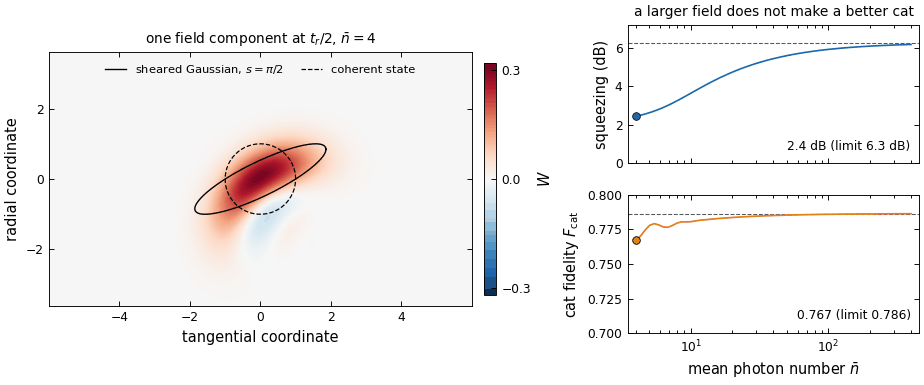

One of the two field components at $t_r/2$, drawn in its own frame (tangential coordinate horizontal, radial coordinate vertical, vacuum units) as $\bar n$ grows from 4 to 400. **Left:** its exact Wigner function. The crescent of a small field straightens, but it does not shrink to a coherent state (dashed circle): it converges to a fixed sheared Gaussian with $s = \pi/2$ (solid contour), because the shear accumulated by half the revival time is the same in vacuum units for every $\bar n$. **Right, top:** the squeezing of the component, which approaches its limit of 6.3 dB slowly (3.6 dB at $\bar n = 10$, 5.9 dB at 100, 6.2 dB at 400). **Right, bottom:** the fidelity of the half-revival field with the best cat state $|\beta\rangle + e^{i\theta}|{-\beta}\rangle$, which is within 1% of its limit $(1+\pi^2/16)^{-1/2} = 0.786$ already at $\bar n = 10$ and never exceeds it.

---

## Static Figures

### Dressed-State Avoided Crossing and $\sqrt{n+1}$ Scaling

  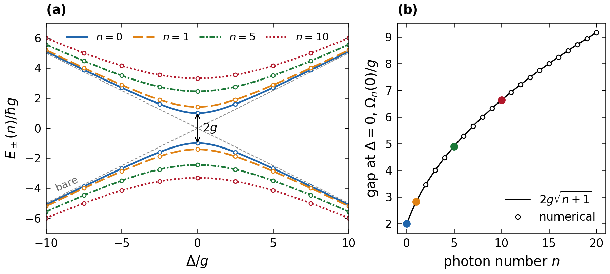

**(a)** Dressed-state energies $E_\pm(n) = \pm\tfrac12\hbar\Omega_n(\Delta)$ as a function of detuning $\Delta/g$ for manifolds $n = 0, 1, 5, 10$ (lines: closed form; open circles: numerical diagonalisation of the QuTiP Hamiltonian, agreeing to machine precision), with the bare levels $\pm\Delta/2$ (dashed grey). The double arrow marks the vacuum Rabi splitting $2g$ of the $n = 0$ manifold. **(b)** Gap at resonance, $\Omega_n(0)/g$, versus photon number $n$: numerical values (circles) on the curve $2\sqrt{n+1}$. The $\sqrt{n+1}$ dependence is the quantum-mechanical fingerprint of the quantized field: a classical drive would produce one Rabi frequency, not a ladder of them.

### Photon Number Distribution at Six Key Times

  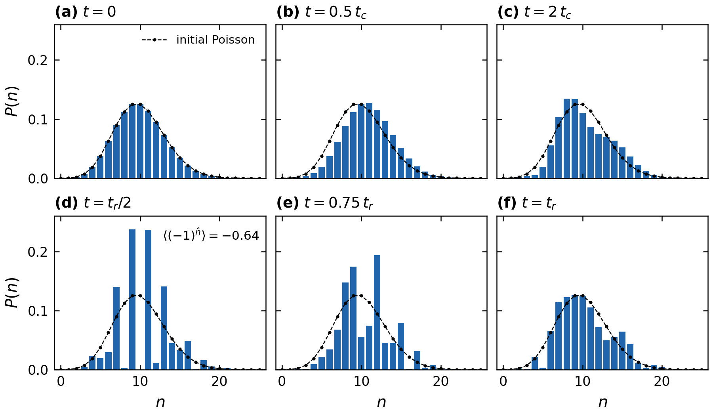

Snapshots of the intracavity photon number distribution $P(n,t)$ at six times during JC evolution ($\bar{n} = 10$, $\Delta = 0$), with the initial Poisson distribution repeated in every panel (dashed). The numerical distribution agrees with the closed form $P(n,t) = p(n)\cos^2(g\sqrt{n+1}\,t) + p(n-1)\sin^2(g\sqrt{n}\,t)$ to $4\times10^{-6}$. **(a)** $t = 0$: Poissonian. **(b)** $t = 0.5\,t_c$: early Rabi oscillation, shifted toward $n+1$. **(c)** $t = 2\,t_c$: collapse. **(d)** $t = t_r/2$ (cat state): odd-$n$ parity comb, $\langle(-1)^{\hat n}\rangle = -0.64$ (the two components have equal $|\beta|$, so the signature is interference between them, not a bimodal split; for odd integer $\bar n$ the comb is even). **(e)** $t = 0.75\,t_r$: partial recombination. **(f)** $t = t_r$ (first revival): unimodal again, broader than the initial Poissonian.

### Bloch Sphere Dynamics of the Reduced Atomic State

  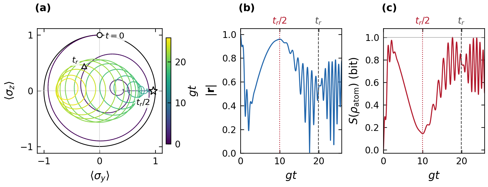

**(a)** Trajectory of the reduced atomic Bloch vector in the $(\langle\sigma_y\rangle, \langle\sigma_z\rangle)$ plane during 1.3 revival times, colour-coded by $gt$ ($\langle\sigma_x\rangle = 0$ throughout, so nothing is lost by the projection). The atom starts at the excited state ($|\mathbf{r}| = 1$), spirals inward during the collapse, returns to $|\mathbf{r}| = 0.96$ on the $\sigma_y$ axis at $t = t_r/2$ (star: atom nearly pure, disentangled from the field cat), and is back inside at $t = t_r$ (triangle, $|\mathbf{r}| = 0.52$: re-entangled). **(b)** Bloch vector length $|\mathbf{r}|(t)$. **(c)** Von Neumann entropy $S(\rho_\text{atom})$. Dotted and dashed lines mark $t_r/2$ and $t_r$.

### Wigner vs Husimi Q-Function Comparison

  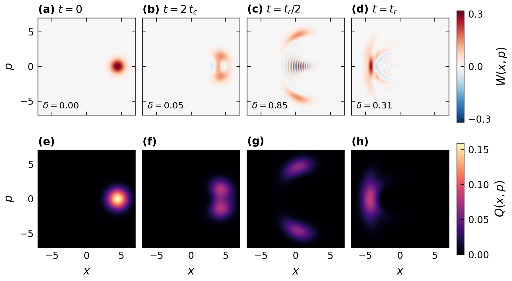

Wigner function (top, **a**–**d**) and Husimi Q function (bottom, **e**–**h**) at $t = 0$, $2\,t_c$, $t_r/2$ and $t_r$, each row on one colour scale. Each Wigner panel is annotated with the negativity $\delta$. At $t = t_r/2$ the Wigner function exhibits oscillatory fringes with $\delta = 0.85$, while the Q function shows only two smooth, positive peaks. At $t = t_r$, residual negativity ($\delta = 0.31$) reflects imperfect refactorization.

### Cat-State Survival Phase Diagram

  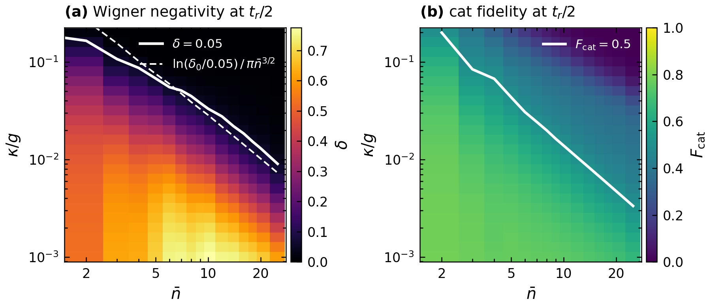

Systematic 2D parameter sweep (16 values of $\bar n$ × 25 values of $\kappa/g$ = 400 Lindblad simulations, with $\kappa/g$ on a logarithmic grid from $10^{-3}$ to 0.2 plus $\kappa = 0$) mapping cat-state survival at $t = t_r/2$. **(a)** Wigner negativity $\delta(\bar{n}, \kappa/g)$. The solid white line is the boundary $\delta = 0.05$ below which the interference fringes are effectively gone; the dashed line is the estimate $\kappa_c/g = \ln(\delta_0/0.05)/\pi\bar n^{3/2}$ from the fringe-decoherence integral (Sec. 3 of the theory notes). The boundary lies at $\kappa_c/g = 0.107$, 0.033 and 0.009 for $\bar n = 3$, 10 and 25; it is not a single power law, steepening from about $\bar n^{-1}$ at small $\bar n$ to $0.95\,\bar n^{-1.43}$ for $\bar n \ge 10$, close to the $\bar n^{-3/2}$ of the estimate. **(b)** Cat fidelity $F_\text{cat} = \max_{\beta,\theta}\langle\text{cat}|\rho_\text{field}|\text{cat}\rangle$ with $|\text{cat}\rangle \propto |\beta\rangle + e^{i\theta}|-\beta\rangle$ and $\beta$ near $i\sqrt{\bar{n}}$. The JC cat lives on the $p$ axis and its relative phase depends on $\bar n$, so comparing with the even cat $|\alpha\rangle + |-\alpha\rangle$ on the real axis would give $F \approx 0$ for every $\bar{n} \gtrsim 3$. Without dissipation $F_\text{cat} \approx 0.78$ for every $\bar{n}$ from 2 to 25: the JC interaction produces a cat of essentially fixed quality. The $F_\text{cat} = 0.5$ boundary (white) lies below the $\delta = 0.05$ boundary, by a factor of 1.3 at $\bar n = 3$ rising to 2.7 at $\bar n = 25$ (0.014 against 0.033 at $\bar n = 10$).

### Cat-State Survival: Parameter Slices

  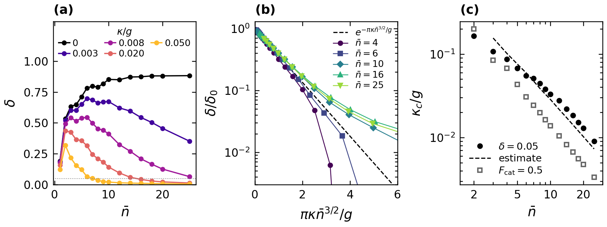

**(a)** $\delta$ versus $\bar{n}$ at fixed $\kappa/g$. Without dissipation (black) the negativity grows with $\bar{n}$ and saturates near $\delta \approx 0.88$ for $\bar{n} \gtrsim 14$; with any loss it peaks at small $\bar n$ and then falls. The dotted line marks $\delta = 0.05$. **(b)** Scaling collapse: $\delta/\delta_0$ against $\pi\kappa\bar n^{3/2}/g$ for $\bar n = 4$–25. All curves follow $e^{-x}$ (dashed) down to $\delta/\delta_0 \approx 0.2$; beyond that small $\bar n$ falls faster and large $\bar n$ more slowly than the estimate. **(c)** The boundaries $\kappa_c(\bar n)$ for $\delta = 0.05$ (filled) and $F_\text{cat} = 0.5$ (open) with the estimate (dashed).

### Photon Blockade: $g^{(2)}(0)$ vs Coupling Strength

  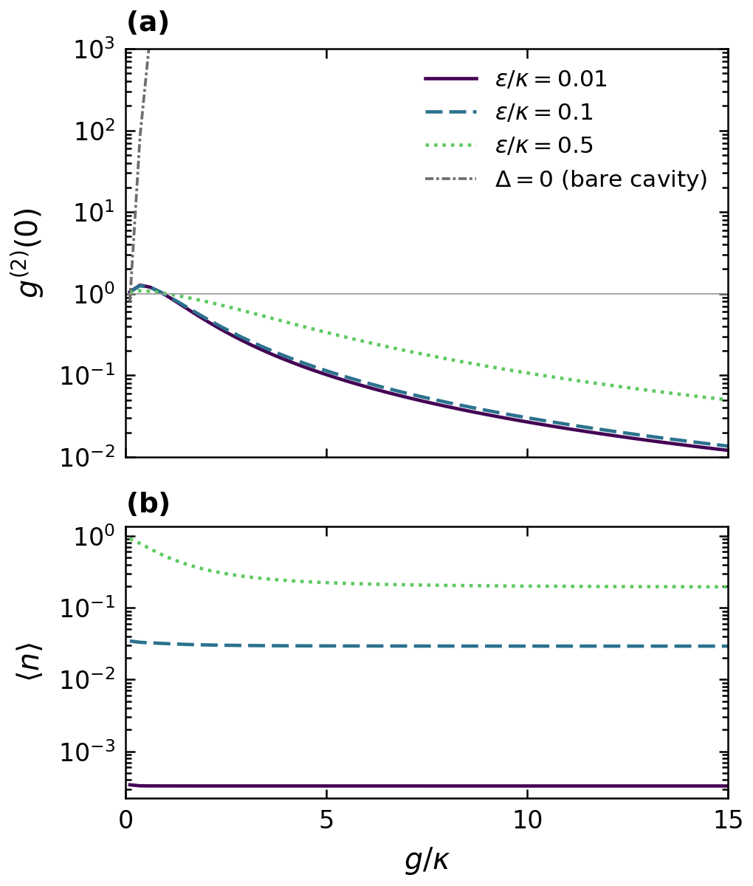

**(a)** Equal-time second-order coherence $g^{(2)}(0)$ of the intracavity field as a function of the vacuum Rabi coupling $g/\kappa$, with the drive resonant with the lower polariton ($\Delta = \omega_c - \omega_L = g$), for drive amplitudes $\varepsilon/\kappa = 0.01$, 0.1 and 0.5. At weak coupling ($g \ll \kappa$) the cavity responds linearly and $g^{(2)}(0) \to 1$ (a coherently driven damped cavity is in a coherent state). As $g$ exceeds $\kappa$ the anharmonic JC ladder blocks the second photon and $g^{(2)}(0)$ falls steadily (0.10 at $g/\kappa = 5$, 0.03 at $g/\kappa = 10$ for $\varepsilon/\kappa = 0.05$); weaker drives give deeper antibunching. The grey dash-dotted line shows the same sweep with the drive on *bare-cavity* resonance ($\Delta = 0$): the laser is then detuned from both polaritons while the two-photon transition $|0\rangle \to |2,\pm\rangle$ is only $g/\sqrt{2}$ away, so $\langle n\rangle$ collapses to $\sim 10^{-8}$ and $g^{(2)}(0)$ climbs to $\sim 10^7$: strong *bunching*, not blockade. **(b)** Mean intracavity photon number $\langle n \rangle$ at $\Delta = g$.

### Photon Statistics vs Drive Strength

  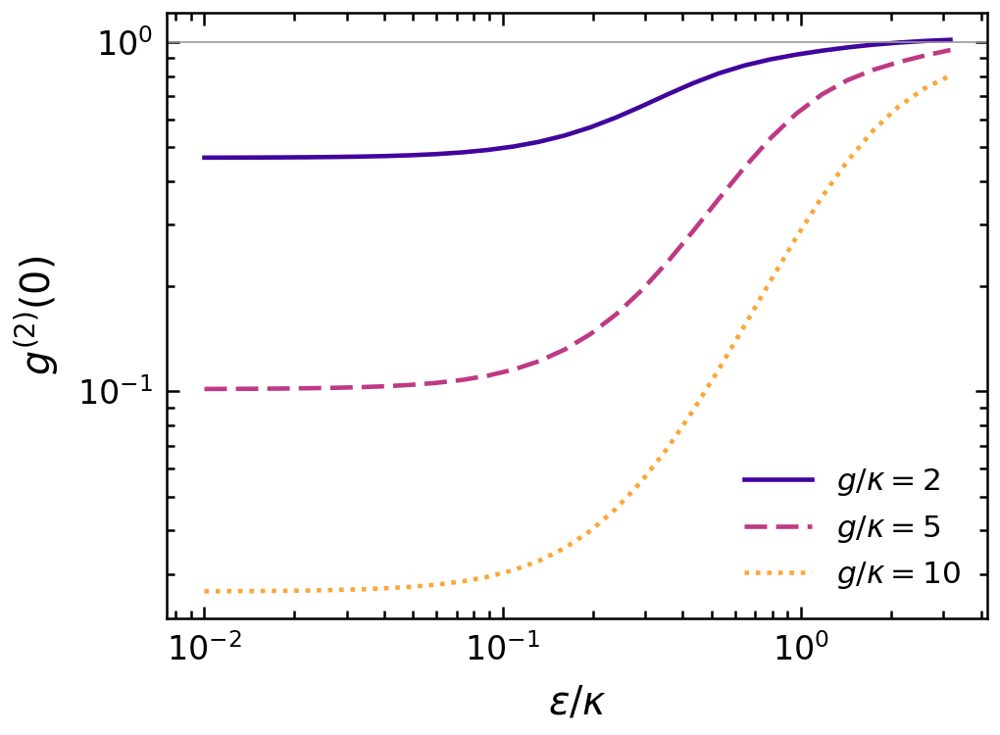

$g^{(2)}(0)$ as a function of drive strength $\varepsilon/\kappa$ for $g/\kappa = 2$, 5 and 10, drive on the polariton ($\Delta = g$). At weak drive the blockade sets $g^{(2)}(0) \approx 0.5$, 0.10 and 0.03. As $\varepsilon/\kappa$ grows past $\sim 0.3$ the drive overwhelms the anharmonicity and $g^{(2)}(0)$ rises monotonically toward the coherent-state value 1. Stronger coupling maintains antibunching to higher drive powers.

### Photon Blockade Spectrum

  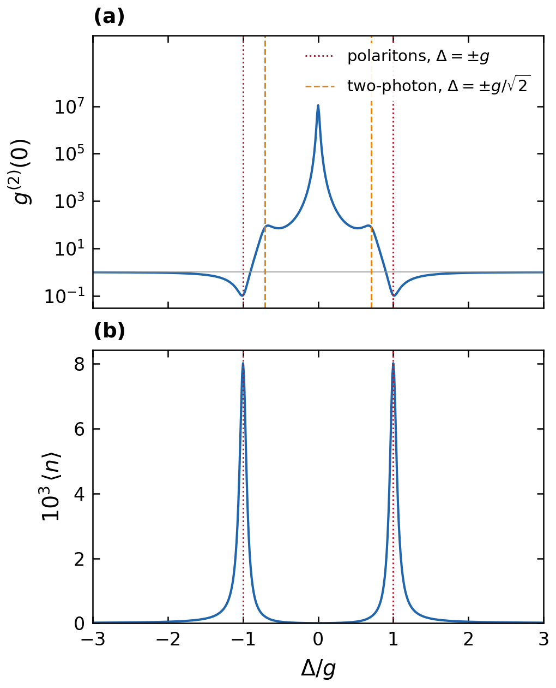

**(a)** $g^{(2)}(0)$ as a function of laser-cavity detuning $\Delta/g$ for $g/\kappa = 5$, $\varepsilon/\kappa = 0.05$ (log scale). The antibunching dips ($g^{(2)}(0) = 0.10$) occur *at* the polariton resonances $\Delta = \pm g$ (dotted red lines): the first photon is absorbed resonantly, the second is blocked by the anharmonic ladder. Between them, the two-photon resonances at $\Delta = \pm g/\sqrt{2}$ (dashed orange lines), where $2\omega_L$ matches $E_{2,\pm}$, produce strong bunching ($g^{(2)}(0) \sim 10^2$), and on bare resonance $\Delta = 0$ the drive is far from every single-photon transition, $\langle n\rangle$ is tiny and $g^{(2)}(0)$ reaches $\sim 10^7$. **(b)** Vacuum Rabi doublet in the cavity transmission $\langle n \rangle(\Delta)$: the splitting of $2g$ is the spectroscopic signature of strong coupling.

### $g^{(2)}$ Combined Summary

  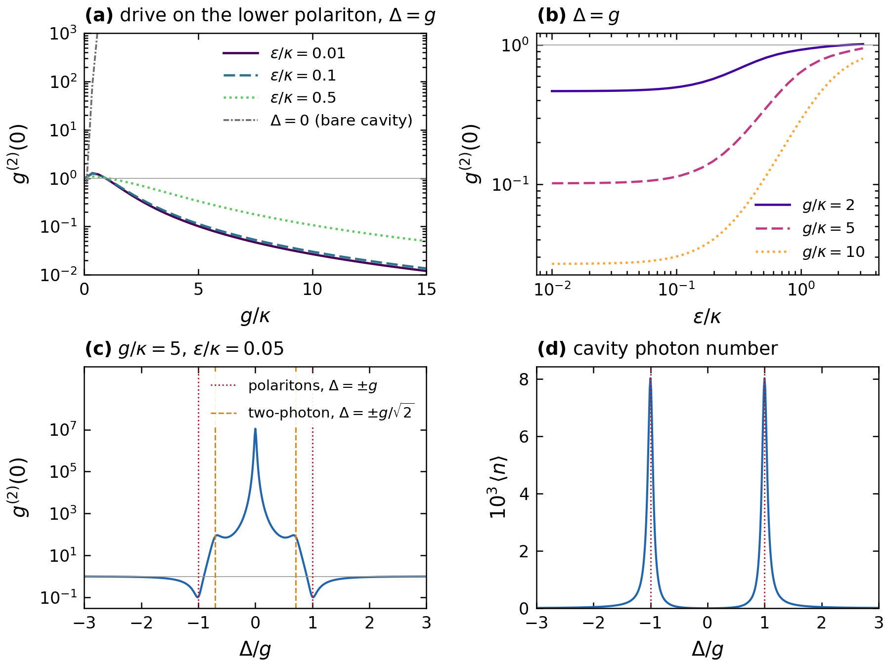

Four-panel summary of photon blockade physics (drive on the polariton, $\Delta = g$, unless stated): **(a)** blockade transition vs $g/\kappa$, with the bare-resonance ($\Delta = 0$) bunching curve for contrast, **(b)** quantum-to-classical crossover vs drive strength, **(c)** blockade spectrum, **(d)** vacuum Rabi splitting in transmission.

### Cat-State Detail

  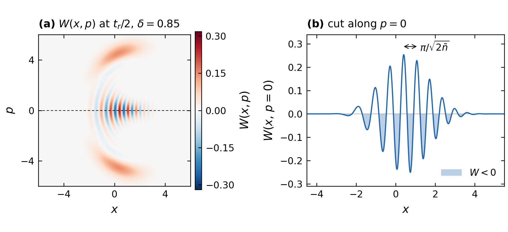

**(a)** Wigner function at the cat-state time $t = t_r/2$ ($\delta = 0.85$, purity 0.96, $F_\text{cat} = 0.78$). **(b)** Its cut along $p = 0$, evaluated exactly on that line: negative fringes reach $W = -0.25$, with fringe spacing $\pi / \sqrt{2\bar{n}} \approx 0.70$ (0.68 measured). An ideal two-coherent-state cat of the same amplitude would have $\delta = 0.63$; the JC value is larger because the two components are themselves deformed.

### Entanglement Across Field States

  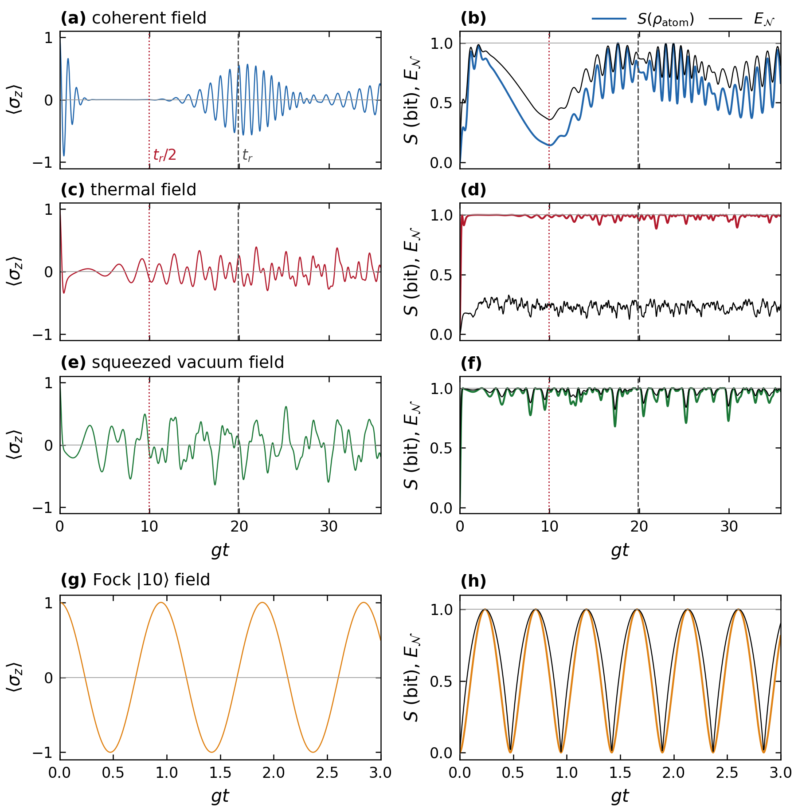

Rows are the four initial fields with $\bar{n} = 10$; the left column is the inversion, the right column the reduced-atom entropy $S(\rho_\text{atom})$ (solid) and logarithmic negativity $E_\mathcal{N}$ (dashed). **Coherent** (a, b): collapse to ~1 bit, then a minimum $S = 0.14$ bit at $t_r/2$ (atom–field disentanglement; the field is the cat), then re-entanglement toward $t_r$. **Thermal** (c, d): $S$ saturates at 1 bit but $E_\mathcal{N} \approx 0.2$: the global state is mixed and most of $S$ is classical correlation. **Squeezed vacuum** (e, f): partial dips only. **Fock $|10\rangle$** (g, h, shorter time axis): strictly periodic, inversion period $\pi/(g\sqrt{11})$ and entropy period $\pi/(2g\sqrt{11})$. The thermal state uses $N_\text{cav} = 150$ and the squeezed vacuum $N_\text{cav} = 300$ ($N_\text{cav} = 50$ would truncate 1–3% of their weight and lower $\langle n\rangle$ to 9.6 and 9.2; for the squeezed vacuum even $N_\text{cav} = 150$ leaves $1.6\times10^{-4}$ outside).

### Entropy Scaling with Photon Number

  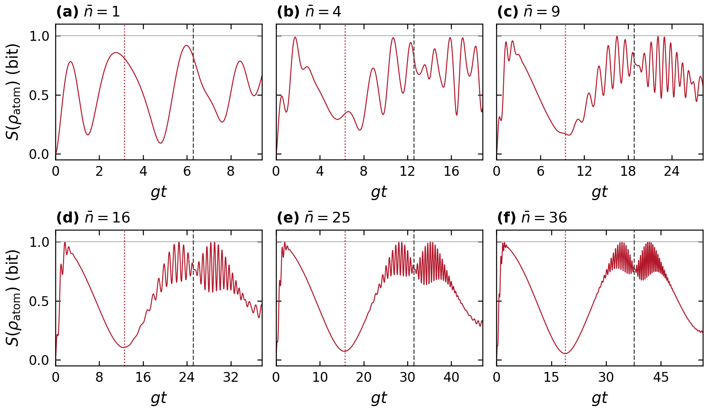

The collapse time $t_c \sim 1/g$ is independent of $\bar{n}$, while the half-revival time $\pi\sqrt{\bar{n}}/g$ (dotted) and $t_r = 2\pi\sqrt{\bar{n}}/g$ (dashed) scale as $\sqrt{\bar{n}}$. The entropy minimum at $t_r/2$ (disentanglement) deepens with $\bar{n}$ and is cleanly resolved for $\bar{n} \gtrsim 9$.

### Dissipative Entanglement

  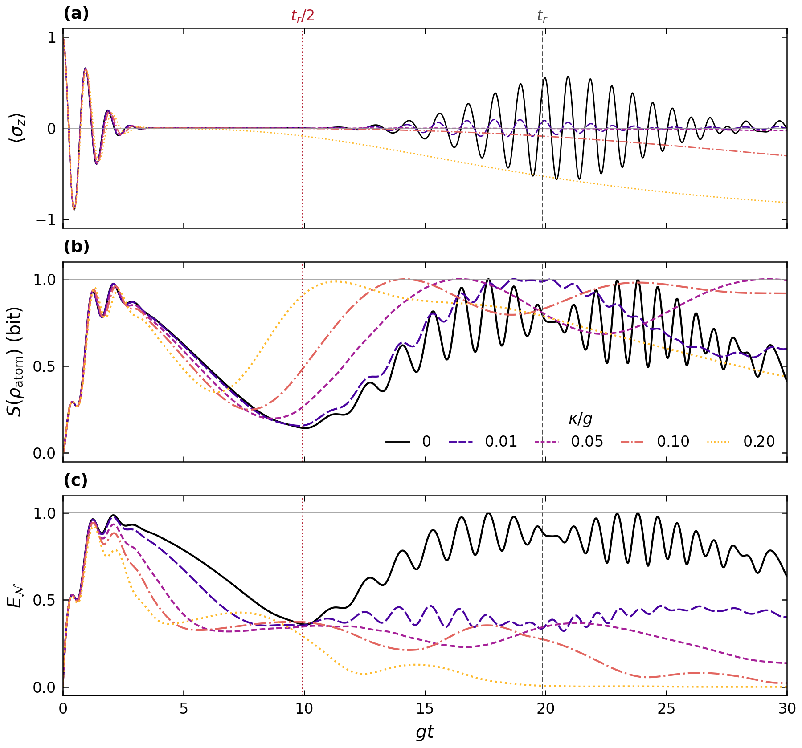

Inversion (a), reduced entropy (b) and logarithmic negativity $E_\mathcal{N}$ (c) under cavity loss, $\kappa/g = 0$, 0.01, 0.05, 0.10 and 0.20 (dark to light, with different line styles). For $\kappa > 0$ the global state is mixed, so $S$ no longer measures entanglement: at $gt = 30$ it is still 0.99 and 0.92 bit for $\kappa/g = 0.05$ and 0.10 while $E_\mathcal{N}$ has fallen to 0.14 and 0.02 (for $\kappa/g = 0.2$ both decay as the atom relaxes to its ground state). The inversion revival is gone by $\kappa/g = 0.05$, whereas $E_\mathcal{N}(t_r/2) = 0.35$–$0.37$ is almost unchanged up to $\kappa/g = 0.10$.

### Decoherence Table

| $\kappa/g$ | Wigner negativity $\delta$ | $\delta(\kappa)/\delta(0)$ | Field purity |
|-----------|--------------------------|--------------|--------------|
| 0.00      | 0.851                    | 1.00         | 0.960        |
| 0.02      | 0.143                    | 0.17         | 0.460        |
| 0.05      | 0.021                    | 0.03         | 0.418        |
| 0.10      | 0.002                    | 0.00         | 0.386        |

$\delta = \int|W|\,dx\,dp - 1$ on a 281×281 grid; values converged to three digits between $N_\text{cav} = 35$ and 50 and stable to $10^{-3}$ under halving the grid spacing.

### Coherent vs Thermal Inversion

  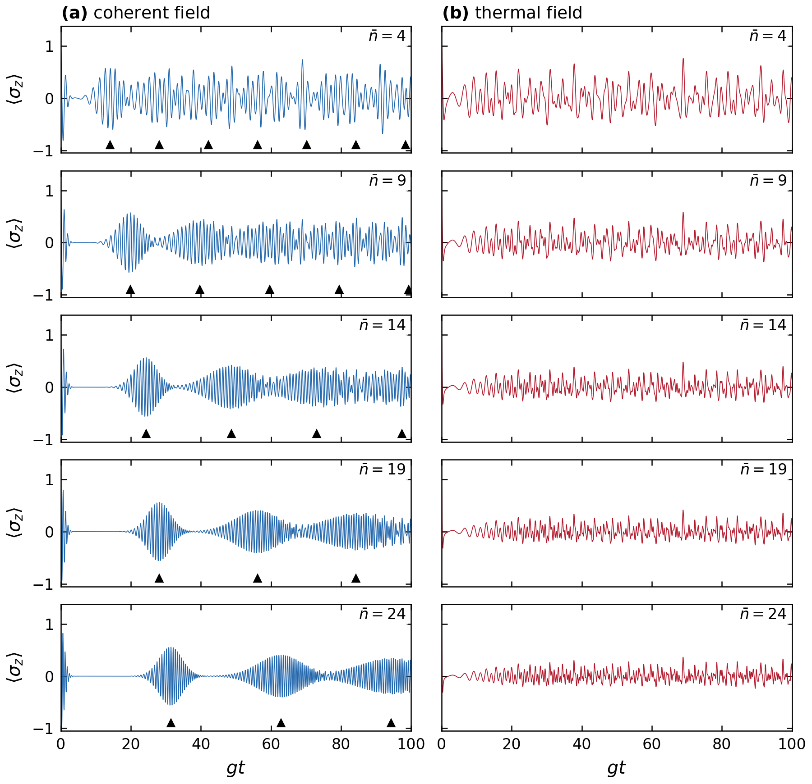

Atomic inversion $\langle\sigma_z\rangle(t) = \sum_n P(n)\cos(2g\sqrt{n{+}1}\,t)$ for coherent (Poisson) and thermal (Bose-Einstein) initial fields at $\bar{n} = 4, 9, 14, 19, 24$; time in units of $1/g$. Triangles mark the centres of the revivals, $2\pi k\sqrt{\bar{n}+1}/g$ (to leading order $k\,t_r$). The thermal traces fluctuate irregularly, with spikes at multiples of $\pi/g$ where the components with $n+1$ a perfect square rephase. The sum is sampled at 20 points per period of the fastest component; a coarser grid aliases it.

### Mollow Triplet

  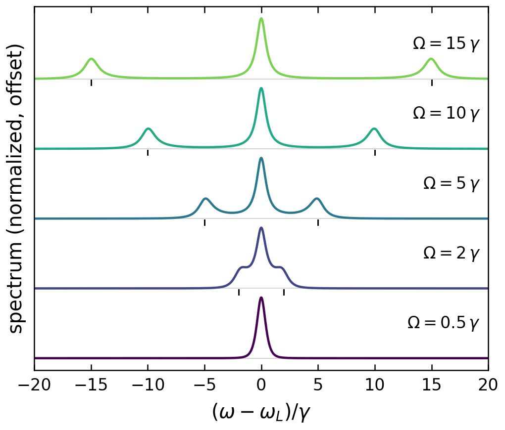

Incoherent resonance-fluorescence spectra via the quantum regression theorem for $\Omega/\gamma = 0.5$–15, each normalised to its peak and offset. Sidebands at $\pm\sqrt{\Omega^2 - \gamma^2/16} \approx \pm\Omega$ (ticks) with HWHM $= 3\gamma/4$; the central-to-sideband peak height tends to 3:1 (0.332 computed at $\Omega = 15\gamma$).

### Static Wigner Functions for Fock States

  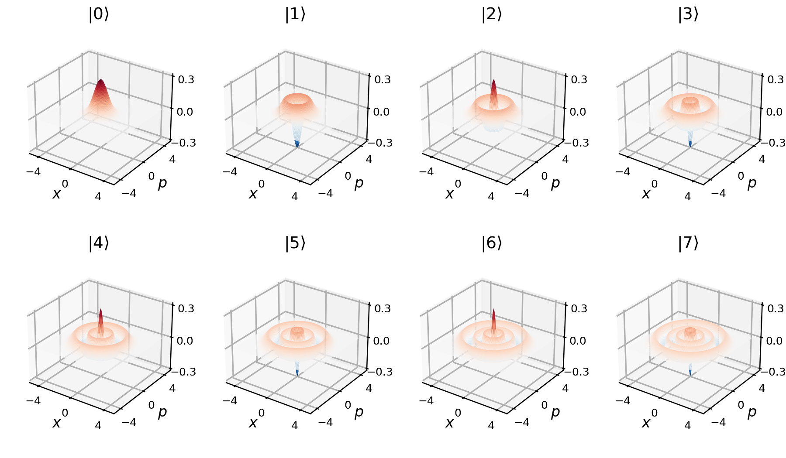

$W_n(x,p) = \frac{(-1)^n}{\pi} L_n(2r^2) e^{-r^2}$ for Fock states $|n\rangle$, all on one colour scale with $W = 0$ white. The number of rings grows with $n$ and $W_n(0,0) = (-1)^n/\pi$.

---

